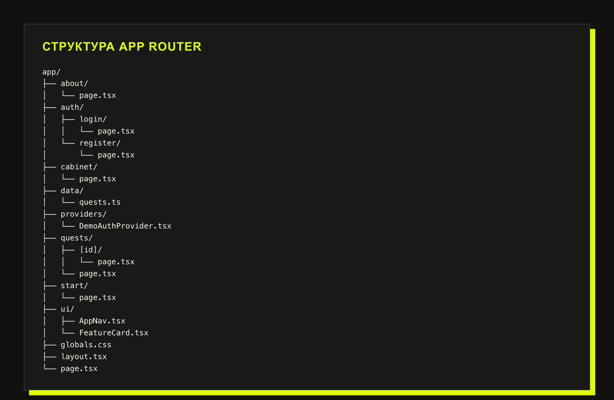
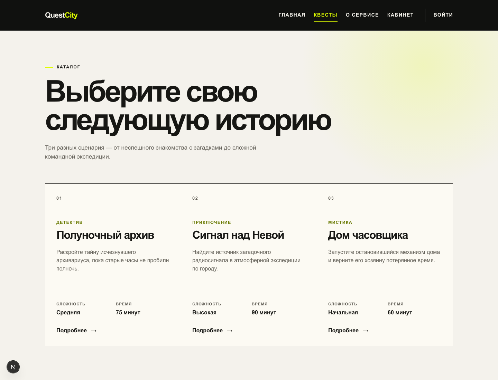
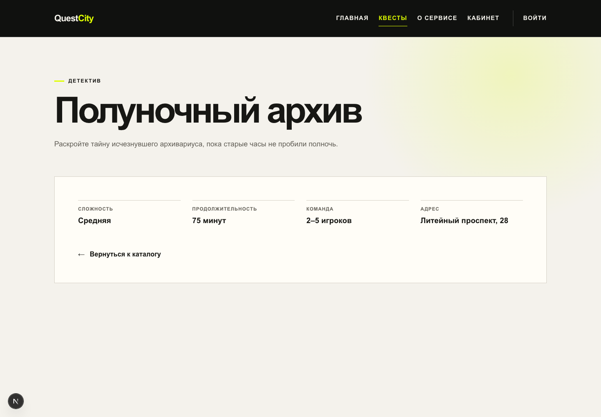
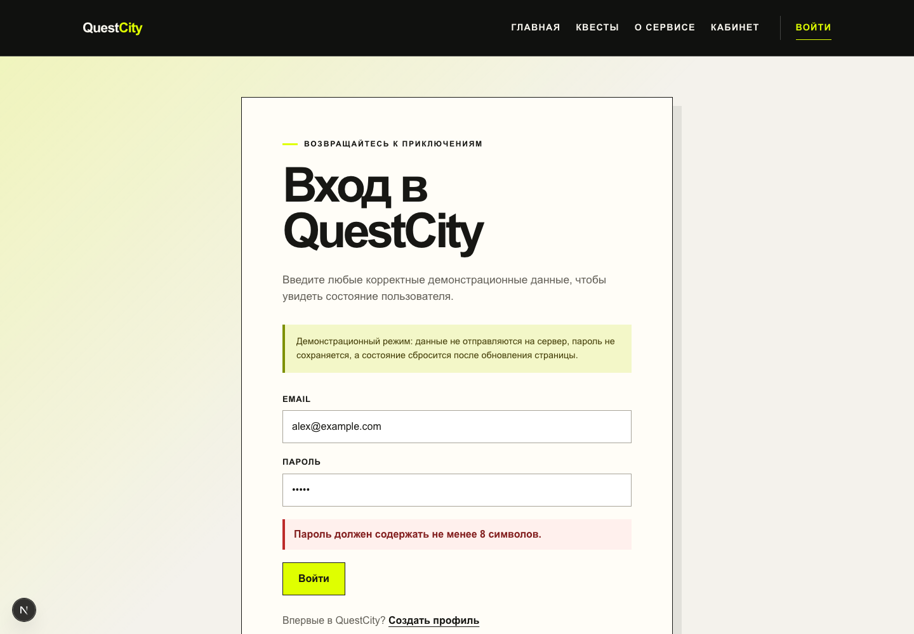
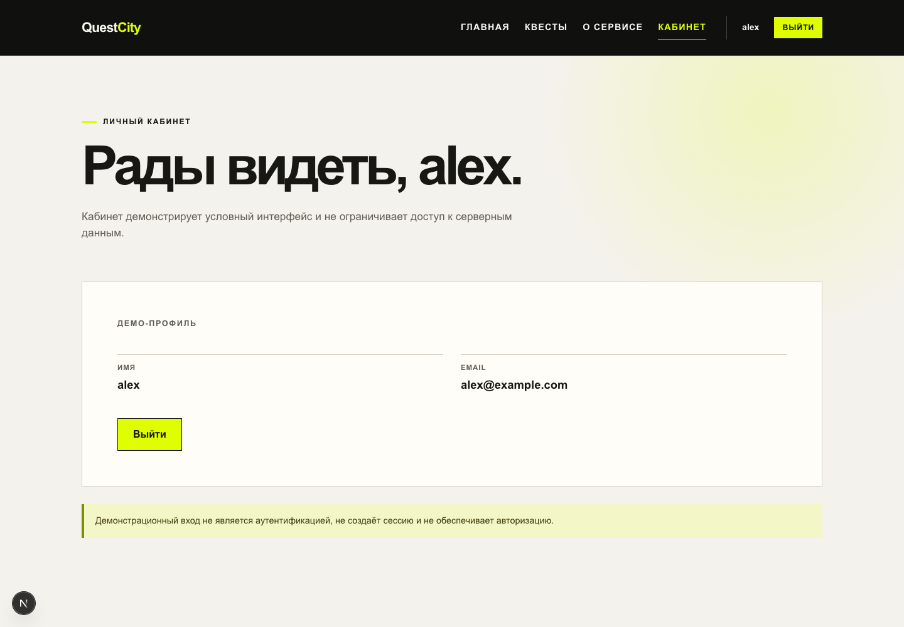
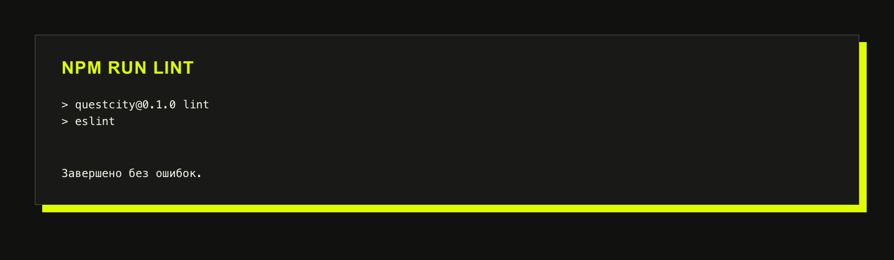
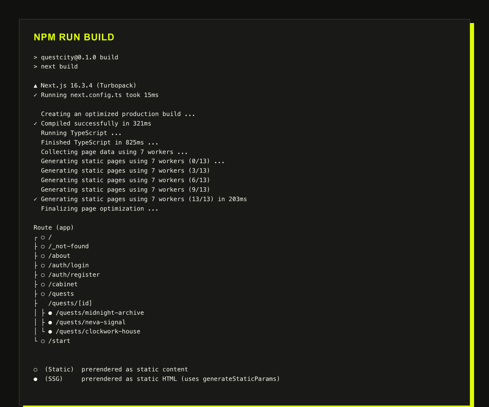

# Отчёт о лабораторной работе № 2

## Создание структуры веб-приложения с помощью App Router. Проектирование авторизации

## 1. Цель работы

Цель работы — разработать структуру многостраничного веб-приложения с помощью App Router, настроить общую навигацию, создать динамический маршрут предметной сущности и реализовать клиентский прототип интерфейса входа и регистрации. Дополнительная цель — закрепить различия между аутентификацией, управлением сессией и авторизацией.

## 2. Продолжение темы QuestCity

В лабораторной работе № 1 был создан начальный каркас QuestCity — агрегатора городских квестов. Во второй работе проект превращён в связанное многостраничное приложение. Посетитель может открыть каталог, перейти к карточке отдельного квеста, изучить информацию о сервисе, а также пройти учебные сценарии входа, регистрации и выхода.

Главной предметной сущностью остаётся **квест**. В учебном наборе данных каждый квест имеет уникальный строковый идентификатор, название, краткое описание и характерные для предметной области свойства. Данные пока хранятся в TypeScript-файле, а не в базе данных.

## 3. Карта разделов

Соответствие назначения разделов, каталогов App Router и URL приведено в таблице 1.

| Назначение раздела | Каталог App Router | URL |
|---|---|---|
| Перенаправление на стартовую страницу | `app/` | `/` |
| Стартовая страница QuestCity | `app/start/` | `/start` |
| Каталог квестов | `app/quests/` | `/quests` |
| Страница отдельного квеста | `app/quests/[id]/` | `/quests/{id}` |
| Информация о сервисе | `app/about/` | `/about` |
| Форма входа | `app/auth/login/` | `/auth/login` |
| Форма регистрации | `app/auth/register/` | `/auth/register` |
| Личный кабинет | `app/cabinet/` | `/cabinet` |

Таблица 1 – Карта разделов QuestCity

## 4. Структура App Router

В Next.js App Router каждый каталог внутри `app` задаёт сегмент URL. Файл `page.tsx` делает сегмент доступным как страницу и формирует её содержимое. Файл `layout.tsx` задаёт общую оболочку для вложенных страниц. Корневой `layout.tsx` обязателен: он объявляет `html` и `body`, подключает общие стили, метаданные, `DemoAuthProvider` и единую навигацию.

Общий `AppNav` выводится на всех страницах. Внутренние переходы реализованы компонентом `Link`. Текущий раздел определяется хуком `usePathname` и отмечается атрибутом `aria-current="page"`. Корневая страница `/` выполняет серверное перенаправление на `/start`.



Рисунок 1 – Структура каталога `app`

## 5. Учебные данные квестов

Тип предметной сущности и массив учебных данных вынесены в отдельный TypeScript-файл. Уникальный `id` применяется в URL динамической страницы. Дополнительные поля описывают жанр, адрес, число игроков, продолжительность или иные важные свойства квеста. Этот массив является демонстрационным и не заменяет базу данных.

Листинг 1 содержит тип `Quest`, учебный массив и функцию поиска по идентификатору.

```ts
// Тип описывает одну предметную сущность каталога городских квестов.
export type Quest = {
  id: string;
  title: string;
  summary: string;
  genre: string;
  difficulty: string;
  duration: number;
  teamSize: string;
  address: string;
};

// Учебные данные хранятся в TypeScript-файле и не являются базой данных.
export const quests: Quest[] = [
  {
    id: "midnight-archive",
    title: "Полуночный архив",
    summary:
      "Раскройте тайну исчезнувшего архивариуса, пока старые часы не пробили полночь.",
    genre: "Детектив",
    difficulty: "Средняя",
    duration: 75,
    teamSize: "2–5 игроков",
    address: "Литейный проспект, 28",
  },
  {
    id: "neva-signal",
    title: "Сигнал над Невой",
    summary:
      "Найдите источник загадочного радиосигнала в атмосферной экспедиции по городу.",
    genre: "Приключение",
    difficulty: "Высокая",
    duration: 90,
    teamSize: "3–6 игроков",
    address: "Петроградская набережная, 8",
  },
  {
    id: "clockwork-house",
    title: "Дом часовщика",
    summary:
      "Запустите остановившийся механизм дома и верните его хозяину потерянное время.",
    genre: "Мистика",
    difficulty: "Начальная",
    duration: 60,
    teamSize: "2–4 игрока",
    address: "Гороховая улица, 41",
  },
];

// Поиск вынесен в функцию, чтобы каталог и динамическая страница работали с одними данными.
export function getQuest(id: string): Quest | undefined {
  return quests.find((quest) => quest.id === id);
}
```

Листинг 1 – Тип и учебные данные квестов

## 6. Каталог и динамический маршрут

Страница каталога остаётся Server Component. Она импортирует типизированный массив, строит карточки с помощью `map` и формирует `Link` вида `/quests/{id}`.

Листинг 2 содержит код каталога.

```tsx
import Link from "next/link";

import { quests } from "@/app/data/quests";

export default function QuestsPage() {
  return (
    <main className="inner-page">
      <section className="page-intro container">
        <p className="eyebrow">Каталог</p>
        <h1>Выберите свою следующую историю</h1>
        <p>
          Три разных сценария — от неспешного знакомства с загадками до
          сложной командной экспедиции.
        </p>
      </section>

      <section className="quest-grid container" aria-label="Каталог квестов">
        {quests.map((quest, index) => (
          <article className="quest-card" key={quest.id}>
            <p className="section-number">{String(index + 1).padStart(2, "0")}</p>
            <p className="quest-card__genre">{quest.genre}</p>
            <h2>{quest.title}</h2>
            <p className="quest-card__summary">{quest.summary}</p>
            <dl className="quest-facts">
              <div>
                <dt>Сложность</dt>
                <dd>{quest.difficulty}</dd>
              </div>
              <div>
                <dt>Время</dt>
                <dd>{quest.duration} минут</dd>
              </div>
            </dl>
            <Link className="text-link" href={`/quests/${quest.id}`}>
              Подробнее <span aria-hidden="true">→</span>
            </Link>
          </article>
        ))}
      </section>
    </main>
  );
}
```

Листинг 2 – Страница каталога



Рисунок 2 – Каталог квестов

Каталог `[id]` является динамическим сегментом. Один файл `app/quests/[id]/page.tsx` обслуживает все адреса квестов. В актуальном App Router значение `params` имеет тип `Promise`, поэтому `id` получается через `await params`. Значение из URL рассматривается как внешнее: если объект не найден, вызывается `notFound()`, и Next.js показывает страницу с кодом 404.

Листинг 3 содержит код динамической страницы.

```tsx
import Link from "next/link";
import { notFound } from "next/navigation";

import { getQuest, quests } from "@/app/data/quests";

// Известные id позволяют заранее подготовить динамические страницы при сборке.
export function generateStaticParams() {
  return quests.map((quest) => ({ id: quest.id }));
}

export default async function QuestPage({
  params,
}: {
  params: Promise<{ id: string }>;
}) {
  // В актуальном App Router params является Promise и читается через await.
  const { id } = await params;
  const quest = getQuest(id);

  if (!quest) {
    notFound();
  }

  return (
    <main className="inner-page quest-detail">
      <section className="page-intro container">
        <p className="eyebrow">{quest.genre}</p>
        <h1>{quest.title}</h1>
        <p>{quest.summary}</p>
      </section>

      <section className="detail-panel container" aria-label="Параметры квеста">
        <dl className="detail-grid">
          <div>
            <dt>Сложность</dt>
            <dd>{quest.difficulty}</dd>
          </div>
          <div>
            <dt>Продолжительность</dt>
            <dd>{quest.duration} минут</dd>
          </div>
          <div>
            <dt>Команда</dt>
            <dd>{quest.teamSize}</dd>
          </div>
          <div>
            <dt>Адрес</dt>
            <dd>{quest.address}</dd>
          </div>
        </dl>
        <Link className="text-link" href="/quests">
          <span aria-hidden="true">←</span> Вернуться к каталогу
        </Link>
      </section>
    </main>
  );
}
```

Листинг 3 – Динамическая страница квеста



Рисунок 3 – Динамическая страница квеста

## 7. Граница между Server Components и Client Components

Статические страницы, не использующие браузерные API, состояние или обработчики событий, сохранены как Server Components. Директива `"use client"` добавлена только там, где она необходима: в провайдере состояния, навигации с `usePathname`, формах и личном кабинете.

## 8. Учебное состояние пользователя

`DemoAuthProvider` хранит `DemoUser | null` в обычном React state и передаёт его дочерним компонентам через контекст. Функция `login` создаёт учебного пользователя из email, `register` — из имени и email, а `logout` устанавливает `user` в `null`. Хук `useDemoAuth` выбрасывает понятную ошибку при вызове вне провайдера.

Пароль не передаётся в провайдер, не записывается в `localStorage` и не сохраняется в файле. После перезагрузки вкладки провайдер монтируется заново, поэтому состояние сбрасывается.

Листинг 4 содержит код провайдера.

```tsx
"use client";

import {
  createContext,
  useContext,
  useMemo,
  useState,
  type ReactNode,
} from "react";

// В контексте хранится только отображаемая информация учебного пользователя.
export type DemoUser = {
  name: string;
  email: string;
};

type DemoAuthContextValue = {
  user: DemoUser | null;
  login: (email: string) => void;
  register: (name: string, email: string) => void;
  logout: () => void;
};

const DemoAuthContext = createContext<DemoAuthContextValue | null>(null);

export default function DemoAuthProvider({
  children,
}: Readonly<{ children: ReactNode }>) {
  // Состояние живёт только в памяти вкладки и намеренно сбрасывается при обновлении.
  const [user, setUser] = useState<DemoUser | null>(null);

  const value = useMemo<DemoAuthContextValue>(
    () => ({
      user,
      login(email) {
        const name = email.split("@")[0]?.trim() || "Гость QuestCity";
        setUser({ name, email: email.trim() });
      },
      register(name, email) {
        setUser({ name: name.trim(), email: email.trim() });
      },
      logout() {
        setUser(null);
      },
    }),
    [user],
  );

  return (
    <DemoAuthContext.Provider value={value}>
      {children}
    </DemoAuthContext.Provider>
  );
}

// Явная ошибка помогает не использовать хук за пределами провайдера.
export function useDemoAuth(): DemoAuthContextValue {
  const context = useContext(DemoAuthContext);

  if (!context) {
    throw new Error("useDemoAuth должен использоваться внутри DemoAuthProvider");
  }

  return context;
}
```

Листинг 4 – Провайдер учебного состояния

## 9. Форма входа

Форма входа является Client Component, так как использует `useState`, обработчик `onSubmit`, контекст и клиентскую навигацию `useRouter`. Поля связаны с `label`, email и пароль имеют соответствующие HTML-типы. Клиентская проверка длины пароля служит только для обратной связи в интерфейсе. После успешной учебной проверки вызывается `login`, затем выполняется переход в личный кабинет.

Листинг 5 содержит код формы входа.

```tsx
"use client";

import Link from "next/link";
import { useRouter } from "next/navigation";
import { useState, type FormEvent } from "react";

import { useDemoAuth } from "@/app/providers/DemoAuthProvider";

export default function LoginPage() {
  const router = useRouter();
  const { login } = useDemoAuth();
  const [email, setEmail] = useState("");
  const [password, setPassword] = useState("");
  const [error, setError] = useState("");

  function handleSubmit(event: FormEvent<HTMLFormElement>) {
    event.preventDefault();

    if (!email.trim() || !email.includes("@")) {
      setError("Введите корректный email.");
      return;
    }

    if (password.length < 8) {
      setError("Пароль должен содержать не менее 8 символов.");
      return;
    }

    setError("");
    login(email);
    router.push("/cabinet");
  }

  return (
    <main className="auth-page">
      <section className="auth-panel">
        <div className="auth-panel__heading">
          <p className="eyebrow">Возвращайтесь к приключениям</p>
          <h1>Вход в QuestCity</h1>
          <p>
            Введите любые корректные демонстрационные данные, чтобы увидеть
            состояние пользователя.
          </p>
        </div>

        <p className="demo-warning">
          Демонстрационный режим: данные не отправляются на сервер, пароль не
          сохраняется, а состояние сбросится после обновления страницы.
        </p>

        <form className="auth-form" onSubmit={handleSubmit} noValidate>
          <div className="form-field">
            <label htmlFor="login-email">Email</label>
            <input
              id="login-email"
              name="email"
              type="email"
              autoComplete="email"
              value={email}
              onChange={(event) => setEmail(event.target.value)}
              required
            />
          </div>
          <div className="form-field">
            <label htmlFor="login-password">Пароль</label>
            <input
              id="login-password"
              name="password"
              type="password"
              autoComplete="current-password"
              minLength={8}
              value={password}
              onChange={(event) => setPassword(event.target.value)}
              required
            />
          </div>
          {error && (
            <p className="form-error" role="alert">
              {error}
            </p>
          )}
          <button className="primary-button" type="submit">
            Войти
          </button>
        </form>

        <p className="auth-switch">
          Впервые в QuestCity? <Link href="/auth/register">Создать профиль</Link>
        </p>
      </section>
    </main>
  );
}
```

Листинг 5 – Форма входа



Рисунок 4 – Форма входа с сообщением об ошибке

## 10. Форма регистрации

Форма регистрации содержит поля имени, email, пароля и повтора пароля. Перед вызовом `register` проверяются минимальная длина и совпадение паролей. После этого создаётся только объект в памяти текущей вкладки. Запись в базу данных не выполняется.

Листинг 6 содержит код формы регистрации.

```tsx
"use client";

import Link from "next/link";
import { useRouter } from "next/navigation";
import { useState, type FormEvent } from "react";

import { useDemoAuth } from "@/app/providers/DemoAuthProvider";

export default function RegisterPage() {
  const router = useRouter();
  const { register } = useDemoAuth();
  const [name, setName] = useState("");
  const [email, setEmail] = useState("");
  const [password, setPassword] = useState("");
  const [passwordConfirmation, setPasswordConfirmation] = useState("");
  const [error, setError] = useState("");

  function handleSubmit(event: FormEvent<HTMLFormElement>) {
    event.preventDefault();

    if (!name.trim()) {
      setError("Введите имя.");
      return;
    }

    if (!email.trim() || !email.includes("@")) {
      setError("Введите корректный email.");
      return;
    }

    if (password.length < 8) {
      setError("Пароль должен содержать не менее 8 символов.");
      return;
    }

    if (password !== passwordConfirmation) {
      setError("Пароли не совпадают.");
      return;
    }

    setError("");
    register(name, email);
    router.push("/cabinet");
  }

  return (
    <main className="auth-page">
      <section className="auth-panel">
        <div className="auth-panel__heading">
          <p className="eyebrow">Начните исследовать город</p>
          <h1>Создание профиля</h1>
          <p>
            Профиль существует только до обновления вкладки и нужен для
            знакомства с интерфейсом.
          </p>
        </div>

        <p className="demo-warning">
          Это прототип регистрации без базы данных, серверной сессии и проверки
          прав доступа.
        </p>

        <form className="auth-form" onSubmit={handleSubmit} noValidate>
          <div className="form-field">
            <label htmlFor="register-name">Имя</label>
            <input
              id="register-name"
              name="name"
              type="text"
              autoComplete="name"
              value={name}
              onChange={(event) => setName(event.target.value)}
              required
            />
          </div>
          <div className="form-field">
            <label htmlFor="register-email">Email</label>
            <input
              id="register-email"
              name="email"
              type="email"
              autoComplete="email"
              value={email}
              onChange={(event) => setEmail(event.target.value)}
              required
            />
          </div>
          <div className="form-field">
            <label htmlFor="register-password">Пароль</label>
            <input
              id="register-password"
              name="password"
              type="password"
              autoComplete="new-password"
              minLength={8}
              value={password}
              onChange={(event) => setPassword(event.target.value)}
              required
            />
          </div>
          <div className="form-field">
            <label htmlFor="register-password-confirmation">Повторите пароль</label>
            <input
              id="register-password-confirmation"
              name="passwordConfirmation"
              type="password"
              autoComplete="new-password"
              minLength={8}
              value={passwordConfirmation}
              onChange={(event) => setPasswordConfirmation(event.target.value)}
              required
            />
          </div>
          {error && (
            <p className="form-error" role="alert">
              {error}
            </p>
          )}
          <button className="primary-button" type="submit">
            Создать профиль
          </button>
        </form>

        <p className="auth-switch">
          Уже есть профиль? <Link href="/auth/login">Войти</Link>
        </p>
      </section>
    </main>
  );
}
```

Листинг 6 – Форма регистрации

## 11. Личный кабинет и условный интерфейс

Личный кабинет показывает два состояния. Если `user` равен `null`, гость видит пояснение и ссылку на форму входа. Если учебный пользователь создан, отображаются его имя, email и кнопка выхода. Навигация тоже реагирует на контекст: гостю показывается ссылка «Войти», а учебному пользователю — имя и кнопка «Выйти».



Рисунок 5 – Личный кабинет после демонстрационного входа

## 12. Стилизация

Глобальная таблица стилей продолжает визуальный язык QuestCity, созданный в первой работе. Добавлены визуально различимые состояния активного пункта навигации, карточек каталога, полей формы, основных кнопок, текстовой ошибки и предупреждения о демонстрационном режиме. Интерфейс сохраняет содержимое при обычной ширине окна.

## 13. Проверка пользовательских сценариев

Для гостя проверены переходы между стартовой страницей, каталогом, двумя динамическими страницами, кабинетом и формой входа. При коротком пароле форма выводит текст ошибки. После демонстрационного входа имя видно в навигации, а данные — в кабинете. Кнопка «Выйти» возвращает гостевое состояние, а полная перезагрузка сбрасывает состояние прототипа. Аналогично проверена регистрация, включая ошибки короткого и несовпадающих паролей.

Для неизвестного `id` динамическая страница возвращает стандартное состояние Not Found, а не пустую разметку или ошибку выполнения.

## 14. Проверка качества проекта

После завершения разработки были выполнены проверка ESLint и производственная сборка.

```text
npm run lint
> questcity@0.1.0 lint
> eslint

Проверка завершена без ошибок и предупреждений.

npm run build
> questcity@0.1.0 build
> next build

▲ Next.js 16.3.4 (Turbopack)
✓ Compiled successfully
✓ Running TypeScript
✓ Generating static pages (13/13)

Сборка сформировала маршруты /, /about, /auth/login, /auth/register,
/cabinet, /quests, /quests/[id] и /start, включая три статических адреса квестов.
```



Рисунок 6 – Результат проверки ESLint



Рисунок 7 – Результат производственной сборки

## 15. Аутентификация, сессия и авторизация

| Понятие | Назначение | Статус в текущей работе |
|---|---|---|
| Аутентификация | Подтверждает личность по учётным данным | Не реализована: форма не сверяет пароль с серверной записью |
| Управление сессией | Сохраняет состояние входа между запросами | Не реализовано: `user` хранится только в памяти React и исчезает после перезагрузки |
| Авторизация | Определяет, к каким маршрутам, данным и действиям разрешён доступ | Не реализована: условный интерфейс не является серверной проверкой прав |

Таблица 2 – Различия между аутентификацией, сессией и авторизацией

### 15.1. Почему прототип не является средством безопасности

Реализованный механизм не является защищённой авторизацией. Пароль не сверяется с хешем на сервере, учётная запись не хранится в базе, подписанная сессионная cookie не создаётся, а права на сервере не проверяются. Объект `user` в React state может управлять видимостью элементов, но не может запретить вызов серверной операции. Поэтому скрытая кнопка или проверка `user !== null` на клиенте не защищают данные.

В реальной системе понадобятся серверная валидация, хеширование паролей, хранение пользователей в PostgreSQL через Prisma, безопасная сессионная cookie с параметрами `HttpOnly`, `Secure` и `SameSite`, а также повторная проверка прав в серверных операциях.

## 16. Ответы на контрольные вопросы

### 1. Как каталог `app` преобразуется в URL?

Каждый каталог внутри `app` задаёт сегмент URL. Маршрут становится доступен, когда в сегменте есть `page.tsx`. Например, `app/auth/login/page.tsx` создаёт `/auth/login`.

### 2. Чем `page.tsx` отличается от `layout.tsx`?

`page.tsx` описывает содержимое конкретного маршрута. `layout.tsx` оборачивает вложенные страницы общей разметкой, сохраняется при переходах между дочерними маршрутами и подходит для навигации и провайдеров.

### 3. Для чего используются квадратные скобки в имени каталога?

Квадратные скобки обозначают динамический сегмент. Каталог `[id]` позволяет одному `page.tsx` обрабатывать разные значения сегмента, например `/quests/night-museum` и `/quests/last-train`.

### 4. Почему `params` в актуальном App Router получают через `await`?

В актуальных версиях Next.js `params` передаётся как `Promise`. Перед чтением `id` промис нужно разрешить оператором `await` в асинхронном компоненте.

### 5. Когда требуется директива `"use client"`?

Она требуется на границе клиентской части, когда компонент использует React state, обработчики событий, эффекты, клиентские хуки Next.js или браузерные API. Статическим страницам она не нужна.

### 6. Какие преимущества даёт `Link` по сравнению с полной перезагрузкой?

`Link` обеспечивает клиентский переход и предзагрузку маршрута. Общие layouts и клиентское состояние сохраняются, а новая страница открывается без полной перезагрузки документа.

### 7. Чем аутентификация отличается от авторизации?

Аутентификация отвечает на вопрос «кто пользователь?» и подтверждает личность. Авторизация отвечает на вопрос «что этому пользователю разрешено?» и проверяет права.

### 8. Для чего нужна сессия?

Сессия сохраняет состояние входа между отдельными HTTP-запросами и позволяет серверу надёжно связать запрос с аутентифицированным пользователем.

### 9. Почему скрытая кнопка не защищает серверную операцию?

Клиентский интерфейс находится под контролем пользователя. Злоумышленник может сформировать HTTP-запрос без кнопки. Поэтому права нужно повторно проверять в серверной операции рядом с источником данных.

### 10. Почему `DemoAuthProvider` сбрасывается после обновления страницы?

Провайдер хранит пользователя только в React state. При полной перезагрузке JavaScript-контекст создаётся заново, а `useState` снова получает начальное значение `null`. Внешнее постоянное хранилище не используется.

### 11. Какие части прототипа будут заменены после подключения PostgreSQL и Prisma?

Учебный TypeScript-массив квестов будет заменён моделями Prisma и записями PostgreSQL. Клиентские `login` и `register` будут заменены серверными операциями с валидацией, поиском или созданием пользователя и хешированием пароля. Вместо временного React state появится серверная сессия, а доступ к данным и операциям будет проверяться на сервере.

## 17. Вывод

В ходе лабораторной работы начальный каркас QuestCity расширен до многостраничного приложения. Освоена файловая маршрутизация App Router, настроена общая навигация, а каталог связан с динамическими страницами квестов. Неизвестные идентификаторы обрабатываются через `notFound`.

С помощью типизированного React Context реализован клиентский прототип входа, регистрации и выхода. При этом соблюдена граница между Server Components и Client Components. Прототип не выдаётся за средство безопасности: в интерфейсе прямо указаны его ограничения, а в отчёте объяснена необходимость серверной аутентификации, сессии и проверки прав.
